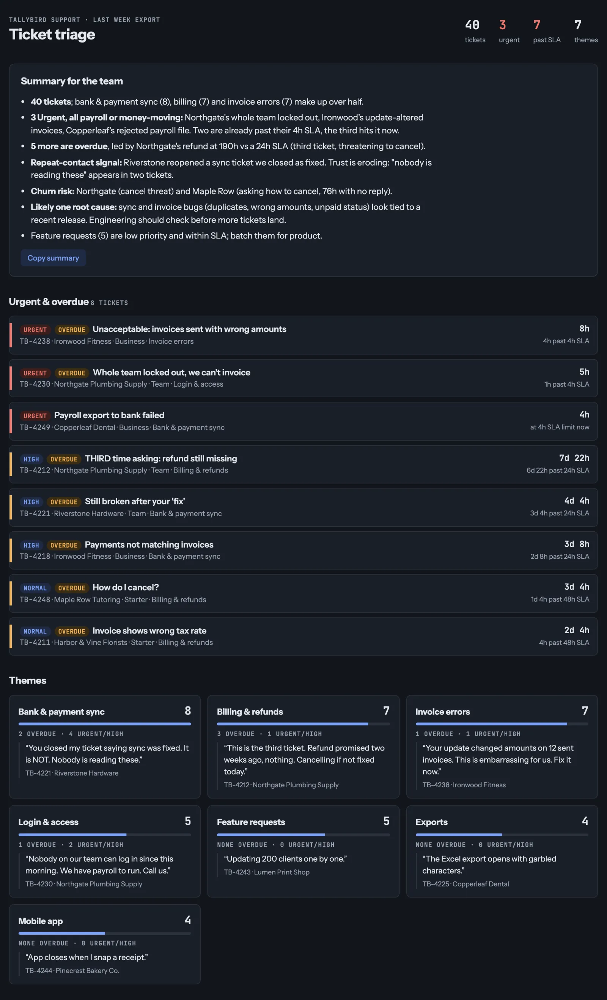
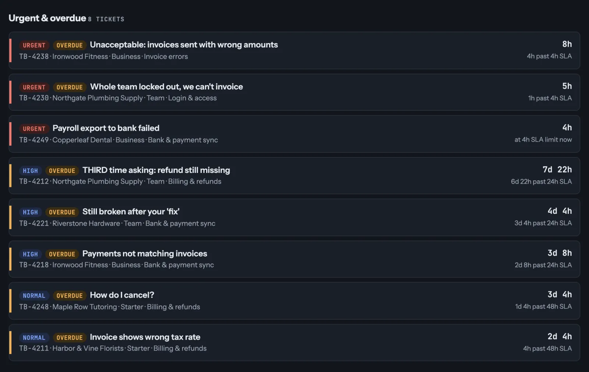

# Weekly ticket summary

Drop last week's help desk export into Claude and get the themes, counts and urgent tickets your team should read first.

A personal app from the [h1902y Library](https://h1902y.com/library/weekly-ticket-summary?utm_source=github&utm_medium=readme&utm_campaign=weekly-ticket-summary): one small AI app for one weekly task. Free to use at work. Version 1.0.0.

## Install the skill

A skill is a saved set of instructions Claude uses whenever the task comes up, so you don't paste the prompt every week.

**In Claude (web or desktop app):**

1. Download [weekly-ticket-summary-skill.zip](https://github.com/h1902y/weekly-ticket-summary/releases/latest/download/weekly-ticket-summary-skill.zip).
2. In Claude, go to **Customize > Skills**, choose **+ > Create skill > Upload a skill**, pick the zip, then turn the skill on.
3. Start a new chat, attach your export and say "weekly ticket summary".

Works on any Claude plan, Free included. Skills need **Code execution** turned on in **Settings > Capabilities**. On a work plan, your admin may need to allow skills first. **New version?** Remove the old skill in **Customize > Skills**, then upload the new zip.

**In Claude Code:**

```text
/plugin marketplace add h1902y/awesome-personal-apps
/plugin install weekly-ticket-summary@personal-apps
```

Then confirm **Install**. To get new versions automatically: run `/plugin`, open **Marketplaces > personal-apps** and choose **Enable auto-update**.

The skill, prompt and sample data are also on GitHub: [h1902y/weekly-ticket-summary](https://github.com/h1902y/weekly-ticket-summary).

## What it does

Every week someone on the support team reads through last week's tickets to answer two questions: what keeps coming up, and who needs a reply today. This app does that first pass.

You give it last week's ticket export. It groups the tickets by theme, counts each one, quotes one real ticket per theme, and puts urgent and overdue tickets on top with how long they've waited. Then it writes a short summary you can read out at your Monday stand-up.

A person still decides what to do. The app makes sure nobody gets missed.

**For:** support and ops leads who review a ticket queue every week. No coding.



## Steps

1. **Export last week's tickets** from your help desk as a CSV. Keep the message, status, priority and "hours open" (or created date) columns. No export handy? Use the [sample tickets](data/sample-tickets.csv).
2. **Open a new chat in Claude** and attach the file.
3. **Paste the prompt** below and send it.
4. **Read "Reply to these first"** before anything else, and check two of the quotes against the file.
5. **Next week:** drop the new export into the same chat and ask again, or install the skill (below) and just say "weekly ticket summary". You get the same shape every week.

## The spec

- **Input:** one week of tickets as a CSV export from any help desk (Zendesk, Freshdesk, Help Scout, Intercom or a spreadsheet). Try it first with the [sample tickets](data/sample-tickets.csv): 40 made-up tickets from a made-up company.
- **Output:** three parts, in the same shape every week: *Reply to these first*, *Themes* (count, share and one quote each) and a 3–5 sentence *Summary*.
- **Rules:**
  - urgent means high priority, past its target time, or an angry or repeat customer;
  - every count matches the file, and every quote is word for word;
  - missing columns are named, never made up.
- **Done when:** you can read the summary in two minutes, and every urgent ticket in the file is on the list.

## The prompt

```text
Build me a small app from this ticket export. Group the tickets by theme, count each theme and quote one real ticket for each. Put the urgent and overdue ones on top, with how long each has been waiting. Write a short summary my team can read.
```

This is the prompt from the video. The skill below holds a longer version with the rules spelled out, so the result keeps the same shape every week.

## Example output

Claude may build a small interactive page; the content is the same. What the skill gave back for the sample tickets (the urgent list is cut to five of ten):

**Weekly ticket summary: 40 tickets**

**Reply to these first (10)**

| Ticket | Customer | Problem | Waiting | Why |
|---|---|---|---|---|
| TB-4212 | Northgate Plumbing Supply | Promised refund still missing | 7.9 d | High priority; 166 h past 24 h SLA; third time asking; says cancelling if not fixed today |
| TB-4221 | Riverstone Hardware | Sync still broken after ticket closed as fixed | 4.2 d | High priority; 76 h past 24 h SLA; repeat contact, angry |
| TB-4218 | Ironwood Fitness | Paid invoices show unpaid, month-end close blocked | 3.3 d | High priority; 56 h past 24 h SLA |
| TB-4238 | Ironwood Fitness | Update changed amounts on 12 sent invoices | 8 h | Urgent priority; 4 h past 4 h SLA; angry |
| TB-4230 | Northgate Plumbing Supply | Whole team locked out, payroll to run | 5 h | Urgent priority; 1 h past 4 h SLA |

**Themes**

| Theme | Tickets | Share | Example |
|---|---|---|---|
| Bank and payment sync | 8 | 20% | "Paid invoices still show as unpaid. Our books are wrong and month-end close is blocked." (TB-4218) |
| Billing and refunds | 7 | 17.5% | "Refund promised two weeks ago, nothing." (TB-4212) |
| Invoice errors | 7 | 17.5% | "Your update changed amounts on 12 sent invoices." (TB-4238) |
| Login and access | 5 | 12.5% | "Nobody on our team can log in since this morning." (TB-4230) |
| Feature requests | 5 | 12.5% | "Updating 200 clients one by one." (TB-4243) |
| Exports | 4 | 10% | "Full-year export fails after a minute." (TB-4226) |
| Mobile app | 4 | 10% | "App closes when I snap a receipt." (TB-4244) |

**Summary**

Sync was the biggest theme with 8 of 40 tickets (20%), and it holds 4 of the 10 urgent ones, including Riverstone Hardware writing back after their ticket was closed as fixed. Northgate Plumbing Supply's third refund request has waited 7.9 days against a 24-hour SLA, and they say they will cancel if it isn't fixed today. Three Urgent tickets came in within the last 8 hours, and two are already past their 4-hour SLA. Ten tickets need a reply today, seven of them already past SLA.

*40 rows read, 0 skipped, no columns missing.*

And the app Claude built from the prompt in the video, urgent tickets first:



## Make it an app

Want a page you can drop next week's file into? In the same chat, ask Claude: "Turn this into an app where I can upload next week's export and get the same three sections." Claude builds it as an artifact you can open again next week.

Before you upload a real export, check your company's rules on AI tools and customer data.

Want to build your own, for your own task? Live workshop: [h1902y.com/workshop](https://h1902y.com/workshop?utm_source=github&utm_medium=readme&utm_campaign=weekly-ticket-summary).

## Other agents

- **Codex:** `codex plugin marketplace add h1902y/awesome-personal-apps`, then `codex plugin add weekly-ticket-summary@personal-apps`.
- **Cursor, Copilot, Gemini CLI and other `.agents` readers:** copy `skills/weekly-ticket-summary/` to `~/.agents/skills/`.
- **Every app at once:** install `personal-apps@personal-apps` instead. Pick one or the other: with both, the same skill shows twice.

## More like this

A new personal app every Tuesday, plus the free 5-day course, *Build your first AI app in 5 days*: [h1902y.com/library](https://h1902y.com/library?utm_source=github&utm_medium=readme&utm_campaign=weekly-ticket-summary).

- All apps: [h1902y/awesome-personal-apps](https://github.com/h1902y/awesome-personal-apps).
- **Ask for the next app** (the weekly task you'd hand off) or **show what you built**: [Discussions](https://github.com/h1902y/awesome-personal-apps/discussions).

## Licence

Content and sample data: [CC BY 4.0](LICENSE). Skill: [MIT](LICENSE-CODE). Made by h1902y; please keep the credit if you share it.
